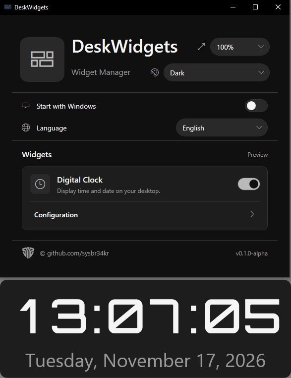
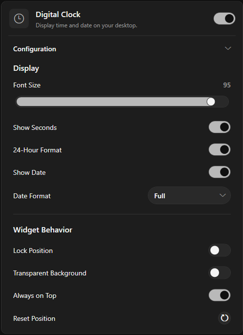

# DeskWidgets

**A lightweight, customizable desktop widget application for Windows.**

DeskWidgets is an open-source desktop application built with C# and WPF. It provides configurable widgets that can remain on your desktop independently of the main application window.

The project focuses on a minimalist interface, customization, and a modular architecture that allows new widgets to be introduced over time.

> **Development status:** Alpha — DeskWidgets is under active development. Features and behavior may change between releases.

## Screenshots

| Widget Manager - Digital Clock | Digital Clock Configuration |
|:---:|:---:|
|  |  |

## Features

### Currently available

- **Digital Clock**
  - 12-hour and 24-hour time formats
  - Optional seconds display
  - Optional date display with multiple formatting options
  - Adjustable font size
- **Widget customization**
  - Position locking
  - Transparent backgrounds
  - Always on Top
  - Reset widget position
  - Individual widget context menus
- **Application**
  - Dark and Light themes
  - Adjustable interface scaling
  - English and Brazilian Portuguese localization
  - Persistent settings
  - Multi-monitor support
  - System tray integration
  - Optional Windows startup with silent launch
  - Single-instance enforcement

### Planned features

- Calendar widget
- Alarm widget
- To-Do List widget
- Shared notification system
- Additional customization options

Planned features are subject to change.

## Download and installation

DeskWidgets is designed for Windows 10 and Windows 11.

1. Open the [Releases](../../releases) page.
2. Download the latest available Windows release.
3. Extract the archive to a folder of your choice.
4. Run `DeskWidgets.exe`.

For builds published as self-contained applications, a separate .NET runtime installation is not required.

**Note:** If you enable *Start with Windows*, keep DeskWidgets in a permanent location. Moving the executable may require updating the startup setting.

## Usage

The **Widget Manager** is used to enable, disable, and configure available widgets.

Once enabled, widgets can be positioned independently on your desktop. Right-click a widget to access its settings and shared behaviors.

Closing the Widget Manager hides it in the system tray without closing active widgets.

To reopen the Manager, double-click the DeskWidgets tray icon or select **Open Widget Manager** from its context menu.

To completely exit the application, select **Exit DeskWidgets** from the tray menu.

## Building from source

### Requirements

- Windows 10 or Windows 11
- .NET 10 SDK

### Build

Clone the repository:

```bash
git clone https://github.com/YOUR_USERNAME/DeskWidgets.git
cd DeskWidgets
```

Restore and build:

```powershell
dotnet restore
dotnet build
```

Run the application:

```powershell
dotnet run
```

Create a release build:

```powershell
dotnet publish -c Release -r win-x64 --self-contained true -p:PublishSingleFile=true -p:EnableCompressionInSingleFile=true
```

## Development

DeskWidgets uses two primary branches:

| Branch | Purpose |
|---|---|
| `main` | Stable, tested versions |
| `develop` | Active development and upcoming features |

Compiled application builds are distributed through [GitHub Releases](../../releases), rather than committed directly to the repository.

## Technology

- C#
- .NET 10
- Windows Presentation Foundation (WPF)
- Windows Forms interoperability for system tray integration
- Windows APIs for window appearance and positioning
- JSON-based settings persistence

## License

A license has not yet been specified.

Until a license is added, the repository's source code is publicly viewable but is not automatically licensed for redistribution or modification.

---

**DeskWidgets** — Created by [sysbr34kr](https://github.com/sysbr34kr).
